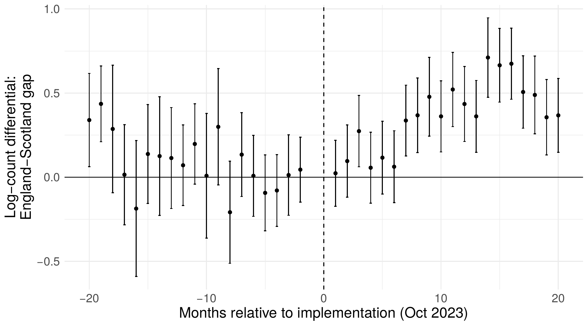

```{r setup, include=FALSE}
knitr::opts_chunk$set(echo = FALSE)
```

Heat pumps are central to cutting carbon emissions from buildings and to
making the UK less exposed to fossil-fuel price shocks. Yet the Boiler Upgrade
Scheme -- the grant that successive governments have kept and expanded to
subsidise heat-pump installations -- has been heavily criticised. Critics
argued it was mostly a transfer of taxpayers' money: to households who would
have bought a heat pump anyway, and to installers who would simply raise their
prices and pocket the grant.

In a new CEP discussion paper --
**[Thin Markets, Thick Subsidies: Local Competition and the Incidence of
Heat-Pump Grants](https://cep.lse.ac.uk/_NEW/PUBLICATIONS/abstract.asp?index=12663)** -- Shefali Khanna, Florian Münch, Aurélien
Saussay and I find the opposite.

On 23 October 2023 the grant for an air-source heat pump in England and Wales
rose from £5,000 to £7,500. Scotland, which runs its own scheme, saw no
change. Comparing 260,000 certified installations in Northern England and
Scotland before and after the change lets us isolate the effect of the larger
grant.



**Installations rose by 24%.** The increase raised monthly installations by
about a quarter relative to Scotland, with no sign of a pre-existing trend,
adding roughly 7,200 heat pumps in Northern England alone over the following
20 months.

**Installers did not pocket the money.** Installation costs fell by about
£830, so households saved more than the extra £2,500. Part of that came from
a shift to smaller, more efficient heat pumps, but even for the same installer
fitting the same model, prices fell by at least £200 -- and by more in areas
with more competition.

**Bigger local markets attracted new installers** and drew existing ones from
further afield. The number of installers active in a neighbourhood in a given
month rose by about a fifth, and the distance between installations and
installers' bases increased. The extra competition pushed prices down, and
both the installation and the price response were larger where the local
installer market was already thick before the policy.

**Good value for public money.** Counting the carbon savings, each £1 of
public money spent on the grant increase delivered about £2.10 in benefits (a
marginal value of public funds of 2.1), rising to 2.5 in the most competitive
markets.

The policy lesson: grant size and installer market thickness are complements,
not substitutes. Demand subsidies for clean technologies work best alongside
measures that bring more installers into local markets -- training,
certification and entry support.

**Paper:** [Thin Markets, Thick Subsidies: Local Competition and the
Incidence of Heat-Pump Grants](https://cep.lse.ac.uk/_NEW/PUBLICATIONS/abstract.asp?index=12663), CEP Discussion Paper 2227
([PDF](https://cep.lse.ac.uk/pubs/download/dp2227.pdf)). Play with the entry model behind the competition result in the
[interactive version](https://mondpanther.github.io/subsidies_competition/).
