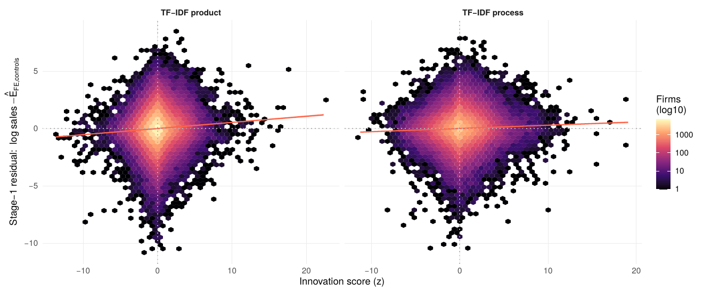

```{r setup, include=FALSE}
knitr::opts_chunk$set(echo = FALSE)
```

Innovation and technological change drive long-run growth. But growth is not everything: its *direction* matters more and more. Is innovation green? Is it inclusive? Answering such questions requires data on what firms actually innovate, and our usual sources have big blind spots. Much of the empirical research uses either patents or firm surveys. Only a small fraction of innovations are ever patented, and surveys are costly, so only a small sample of firms can typically be covered.

In a new CEP discussion paper -- **[Measuring the Prevalence and Direction of Innovation: A Pilot Approach using LLMs](https://cep.lse.ac.uk/_NEW/PUBLICATIONS/abstract.asp?index=12572)** -- Prashant Garg, Peter John Lambert, Ralf Martin and Denis Medvedev propose a different approach: the **Global AI Innovation Survey (GAIIS)**.

### The idea: an innovation survey run through LLM prompts

Information on new products and processes introduced by individual firms is widely available on company web pages, in news reports, in online forums and on social media. Finding and collating these sources is not easy, though, and neither is turning unstructured information, say a newspaper article, into a structured data point that lends itself to empirical economic research. Fortunately, a big part of that effort has already been undertaken when building the latest large language models (LLMs). So we can, in effect, conduct an innovation survey via LLM prompts.

We did so for about 600,000 firms in 40 countries, asking about their recent product and process innovations. The result is a database of nearly 6 million innovations, each with a text description, and each tagged as green, labour-augmenting or labour-saving where the information was available.


*Every innovation in the survey, placed on a map by the meaning of its description (the [GAIISia atlas](https://waibs.org/GAIISia/)). Colours show broad themes of innovation. You can zoom in, search and explore it yourself.*

### Is it just AI slop?

LLMs can hallucinate, so how do we know the information we gather is not meaningless? We test whether it carries economic signal. We use the text of each firm's innovations to predict its productivity, using cross-fitting: every firm is scored by a model that never saw that firm's own sales, so any relationship cannot be mechanical. The resulting innovation indicators are strongly and robustly correlated with firm productivity, even after controlling for sector, country, size and patents. A one-standard-deviation increase in a firm's product innovation index is associated with about 5% higher total factor productivity; for process innovation it is about 2.5%.



*Productivity residual (log sales after inputs, patents and country-by-sector effects) against the cross-fitted product (left) and process (right) innovation scores. Each hexagon is a group of firms; the red line is the fit.*

### What we find

- **Far more firms innovate than patent.** About 40% of firms show evidence of product innovation and over 25% of process innovation, compared with fewer than 4% that hold a patent.
- **Green innovation is also much more widespread than green patents suggest.** 14% of firms have a green product innovation and 12% a green process innovation, against fewer than 1% with a green patent. Still, green innovation in our data is positively correlated with green patenting across countries and sectors, so patent-based measures of the direction of innovation remain informative.
- **Innovation is mostly labour-augmenting.** Labour-augmenting innovations are much more common than labour-saving ones: roughly three times as common for products and twice as common for processes. This holds, with few exceptions, across countries and sectors. Even in Software & IT, where innovation leans most towards automation, slightly more firms engage in labour-augmenting than in labour-saving process innovation.
- **Green and pro-worker go together.** Countries whose firms innovate more in green technologies also tilt more towards labour-augmenting innovation. This is a correlation across countries, not proof of cause, and it says nothing about who ends up gaining. But it suggests that the clean transition can also be inclusive.

### Data

We make the data available to the research community through [innobase](https://www.prinzproject.io/innobase), and hope it inspires many applications beyond ours. It is still an early beta, so feedback is very welcome.

### Caveats

This is a pilot and a single cross-section. Our sample favours firms with a bigger online footprint, and every innovation counts equally, so the measures speak to the prevalence and direction of everyday firm-level innovation rather than to the importance of individual technologies or the technological frontier.

**Paper:** [Measuring the Prevalence and Direction of Innovation: A Pilot Approach using LLMs](https://cep.lse.ac.uk/_NEW/PUBLICATIONS/abstract.asp?index=12572), by Prashant Garg, Peter John Lambert, Ralf Martin and Denis Medvedev.

*This research was supported by the ESRC via the [PRINZ project](https://www.prinzproject.io/).*
